<picture>
  <source media="(prefers-color-scheme: dark)" srcset="./banner-dark.svg">
  
</picture>

  
  
  
  
  

**Sprite AI makes game-ready pixel art sprites with AI.** Type a character, an item or a tile and get a clean sprite from 32x32 up to 400x400. Then animate it into a sprite sheet, turn it to face 8 directions, or restyle it.

This is where our plugins, our MCP server and our open source pixel art tools live.

### Repos

| Repo | What it does |
|---|---|
| [sprite-ai-mcp](https://github.com/sprite-ai-studio/sprite-ai-mcp) | The Sprite AI MCP server. Make sprites from Claude Code, Cursor or any MCP client. |

### Use it

- [Sprite generator](https://www.sprite-ai.art). Text to game sprites, 15 free tokens to start.
- [Pixel animator](https://www.sprite-ai.art/pixel-animation). Walk, run, idle and attack sprite sheets.
- [Free pixel art tools](https://www.sprite-ai.art/tools). 30 tools in the browser, no account needed.
- [MCP server](https://www.sprite-ai.art/mcp). Sprites from your AI editor.
- [REST API](https://www.sprite-ai.art/docs/api-reference). Sprites from your own code.
- [Aseprite extension](https://www.sprite-ai.art/aseprite). Generate and animate inside Aseprite.

Made with pixels at <a href="https://www.sprite-ai.art">sprite-ai.art</a>

